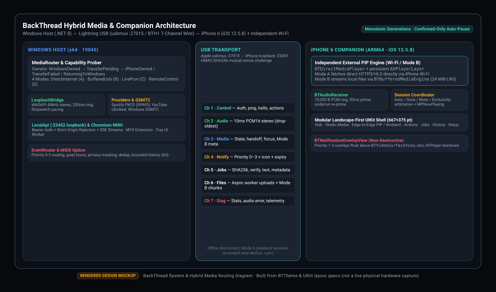

# Architecture

## Processes and Boundaries

BackThread runs as a single user-session coordinator on Windows (`BackThread.Host` or `BackThread.Tray`, no session-zero service or kernel virtual audio driver) paired over Apple Mobile Device Service (`usbmux` loopback `:27015 -> :23451`) with an Objective-C/C native iOS 12 UIKit companion app (`BackThread.app` embedding `BTAgent`).

- **Windows Assemblies**: `BackThread.Host`, `BackThread.Tray`, `BackThread.Audio`, `BackThread.Media`, `BackThread.Events`, `BackThread.Worker`, `BackThread.Transport`, plus `BackThread.Simulator` and `BackThread.DeviceTests`.
- **iOS Native Components (`ARM64`, min `iOS 12.0`, `iPhoneOS 12.4 SDK`)**:
  - **Transport & Audio**: `BTAgent`, `bt_wire.c`, `BTPcmRing.c`, `BTAudioReceiver`, `BTAudioSessionCoordinator`.
  - **Independent External PiP Engine**: `BTDirectMediaPlayer` (persistent `AVPlayerLayer`, `preferredPeakBitRate` caps, wake lock), `BTBufferedMediaEngine` (`backthread-buf://` `AVAssetResourceLoaderDelegate` + 24 MiB LRU), `BTYouTubeEmbedController` (opt-in isolated `youtube-nocookie` `WKWebView`).
  - **Landscape-First UIKit Shell**: `BTViewController`, `BTTheme`, `BTIdleHubView`, `BTNowPlayingView`, `BTVideoSurfaceView`, `BTQuickActionsView`, `BTWorkerStatusView`, `BTSettingsView`, `BTNotificationOverlayView` & `BTHistoryPanelView`.

Long-running background audio on iOS continues to rely on Apple's playback category and `UIBackgroundModes=audio`; no unauthorized `launchd` daemon is installed, and Screen/Wi-Fi PiP stays managed within Apple UIKit/AVFoundation lifecycle rules.

## Transport & Multiplexing (`BTH1`)

`UsbMux` connects directly via public Apple XML-plist frames (zero LGPL libraries linked), filtering USB-attached devices only. After mutual HMAC-SHA256 nonce challenge authentication, one ordered TCP socket carries seven bounded logical channels:

- **Connection.cs**: Pre-allocated pooled frame buffers, non-allocating `TryWrite` fast paths on Channels 1/2/5/6 (depth `8` audio queue evicting oldest frames under burst stalls), reusable `CancellationTokenSource`, write-wait telemetry, and bounded exponential reconnect with jitter.
- **Channel Isolation (`AgentServer.cs` / `BTAgent.m`)**: Non-blocking socket reader; file chunks write/flush on a bounded FIFO worker queue (`Channel.CreateBounded<byte[]>(8)` in simulator / `utilityQueue` in iOS) so concurrent multi-MiB transfers never starve Channel 2 live PCM reads.
- **Reconnect State Sync**: On reconnect, Host sends `media.sync` over Channel 3; iPhone replies with `independentActive`, `generation`, `mode`, `positionSeconds`, `durationSeconds`, and `url` so Windows re-aligns [`MediaRouter`](../src/Windows/Media/MediaRouter.cs) without restarting independent Wi-Fi video.

## Hybrid Media & Audio Coordination

See [HYBRID_MEDIA_ARCHITECTURE.md](HYBRID_MEDIA_ARCHITECTURE.md) and [EXTERNAL_PIP.md](EXTERNAL_PIP.md) for full details:
- **WASAPI Live PCM (`Mode C`)**: `LoopbackBridge` captures 48 kHz 16-bit stereo PCM via NAudio into a **250 ms capture ring (`48,000 B`)**, paced by `Stopwatch.GetTimestamp()` sub-millisecond timing with bounded burst catch-up (`<=3` packets) and zero destructive ring flushes on normal 50 ms OS jitter.
- **iPhone Receiver (`BTAudioReceiver`)**: Fixed **19,200-byte (`100 ms`) PCM ring**, `30 ms` initial pre-prime (`5,760 B`), three `10 ms` (`1,920 B`) `AudioQueue` buffers, and automatic post-underrun re-priming (`_underrunStreak >= 2`).
- **Audio Focus Arbitration**: `BTAudioSessionCoordinator` enforces `Auto`, `IndependentOnly`, `LivePcmOnly`, `KeepVideoMuteAudio`, and `DuckVideo` between `AudioQueue` Live PCM and independent `AVPlayer` items.

## Jobs, Storage, Events & Extensions

- **Worker & Storage**: 2 GiB quota, 64 MiB headroom guard, ASCII basename/traversal validation, atomic SHA-256 verified commits, resumable chunk prefixes, cooperative job cancellation (`sha256`, `verify`, `metadata`, `text`, `diagnostic`), plus ephemeral 256 KiB Mode B buffered media streaming (`BufferedMediaSource`).
- **Notifications (`EventRouter`)**: Priority 0–3 routing, dynamic `High`/`Critical` source lists, privacy masking, deduplication, 10/s rate bound, 64-entry history, non-destructive iOS `BTNotificationOverlayView`, and optional MSIX `Package.appxmanifest` for Windows 10 toast consent (`packaging/msix/`).
- **Integrations**: Authenticated loopback REST + SSE HTTP API (`127.0.0.1:23452`), official Spotify OAuth PKCE (`DPAPI` token storage), compliant YouTube oEmbed adapter, and Chromium MV3 extension (`extensions/chromium/`) communicating via `BackThread.Host.exe --native-messaging`.
