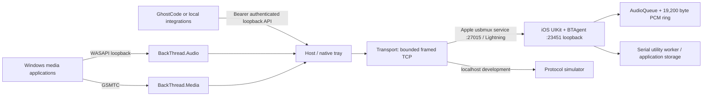

# Architecture

## Native UI 2.0 additions

`BTTheme` owns vector glyphs/colors/bounded images; `BTPageCoordinator` retains lazy pages; `BTCornerDrawer` controls navigation; `BTMediaView` owns one persistent AVPlayer; `BTCompanionPage` supplies reusable grids/lists/settings; `BTNotificationCoordinator` owns bounded history/queue/expiry/privacy. Root coordinates models and main-thread UIKit updates. Shared C interaction decisions are used by production UI and targeted tests.

Windows `AppCatalog` keeps locally approved canonical executables/fixed arguments or packaged identities. Phone receives bounded metadata/icons and sends IDs only. `ICompanionTransport` unifies USB/simulator/TLS leases. Native `BTChannel` preserves raw USB and implements one serialized nonblocking SecureTransport pump for Wi-Fi. Enrollment uses authenticated USB; TLS pin/session/HMAC authenticate before one session takes ownership. Wi-Fi PCM stays disabled.

The latest requested HUD/audio destination and banner-only redesign are not present yet. See current handoff before extending these boundaries.

## Processes and boundaries

Host is the coordinator in the current Windows user session. Tray embeds HostRuntime rather than starting a service in session zero. Host, Audio, Media, Events, Worker, and Transport are separate assemblies. All Windows APIs used by the product are managed platform APIs or NAudio; no kernel driver or virtual endpoint is installed.

The production iOS implementation is Objective-C and C. UIKit owns the visible interface and AVAudioSession lifecycle. BTAgent runs its accept/read loop on a dedicated queue, serial file jobs on a utility queue, and submits UI updates to the main queue. AudioQueue callbacks operate only on a fixed native PCM ring. There is one app process, no WebView, and no injected tweak.

Long-running audio uses the documented playback category and `UIBackgroundModes=audio`. This does not provide unconditional background execution when no audio is active. A launchd daemon is deliberately not installed: audio-session behavior and daemon/UI ownership need real-device validation before introducing a second process. Worker-only survival after UI termination is currently unsupported.

## Transport and recovery

UsbMux implements the public XML-plist usbmux protocol directly; it does not link LGPL libraries. Windows connects to Apple Mobile Device Service, enumerates USB-only devices, and requests the iPhone localhost application port. If several devices are present, an explicit device serial is required. Pair-record availability and usable application connectivity are separate facts.

After mutual nonce/HMAC authentication, one ordered TCP stream carries seven logical channels. One reader and one writer operate concurrently. Control has a bounded 32-frame queue; audio retains six 10 ms frames and evicts old data; bulk has two 32 KiB frames and blocks producers. A slow socket times out rather than growing queues. Control can overtake queued audio and bulk; a frame already in flight is not preempted. This is multiplexing, not independent TCP congestion domains.

Host retries with bounded exponential delay and jitter. Every session starts a new audio negotiation and sample timeline. Ping is sent every three seconds, requests time out, and reads time out after twelve seconds. Job results and partial transfers live in bounded on-disk state. There is no automatic replay of destructive commands.

## Audio

WASAPI captures the default multimedia render endpoint. The Windows audio engine converts to 48,000 Hz signed 16-bit interleaved stereo. Capture runs independently from transport; a ten millisecond pacing loop consumes a 100 ms ring and inserts silence for missing samples. A scoped `timeBeginPeriod(1)` request improves Windows pacing while streaming and is paired with `timeEndPeriod(1)` on shutdown. Endpoint changes restart capture. Late scheduling slots clear stale PCM instead of increasing delay.

The phone uses the same 100 ms capacity ring and three 10 ms AudioQueue buffers. Initial playback primes 30 ms of received PCM; negotiation time is not treated as a sample deadline. Overflow drops complete old stereo samples; underrun fills silence. PCM pacing and simulator playback use dedicated threads, keeping timing separate from general worker continuations. Sequence gaps and occupancy are diagnostic facts, not a substitute for an acoustic latency measurement. TCP stall recovery, output-route changes, screen lock and interruptions still require physical iOS tests.

## Jobs and storage

Files are opaque data in the application-owned storage directory; archives are never extracted. Storage names are ASCII basenames, and traversal and Windows device names are rejected. Upload chunks contain a transfer ID and byte offset. Begin returns the current prefix length; commit verifies the complete SHA-256 then atomically renames the partial file. Admission reserves declared bytes against a default 2 GiB app quota and checks 64 MiB free-space headroom. At most 256 complete files, sixteen partial transfers, eight queued jobs, sixty-four result records, and one active worker are retained.

Jobs implement hashing, integrity verification, metadata, streaming text statistics and named diagnostics. Cancellations are cooperative at chunk boundaries. Restarted in-progress jobs become `interrupted`; callers retry with a new job ID. Upload retry uses a stable content/name-derived transfer ID to resume the existing prefix. This is restart/resume support, not block-delta synchronization.

## Events, controls and offloading

EventRouter applies source filters, privacy masking, expiry, deduplication, a ten-per-second rate limit and a sixty-four-entry history. Permission-dependent Windows notification collection is optional and off by default. The unpackaged app does not present a notification-consent flow; the local event API is the usable integration path.

GSMTC supplies metadata, capability flags, playback commands, seeking and application identity. Thumbnail decoding occurs on Windows; at most a 128-pixel image encoded within 24 KiB reaches the phone. Media presentation updates once per second. Native actions contain only allowlisted IDs; executable paths and arguments are configured locally, never supplied by a remote touch payload.

Modes A and B keep playback on Windows, with B adding PCM streaming. The Mode C abstraction permits explicitly enabled HTTPS direct-media handoff to AVPlayer. It requires independent iPhone connectivity and compatible codecs. YouTube web-page extraction, DRM bypass, internet tethering and unrestricted background YouTube playback are not provided. Mode C compiles but remains partial/runtime-unverified and must not be treated as measured CPU offload.
