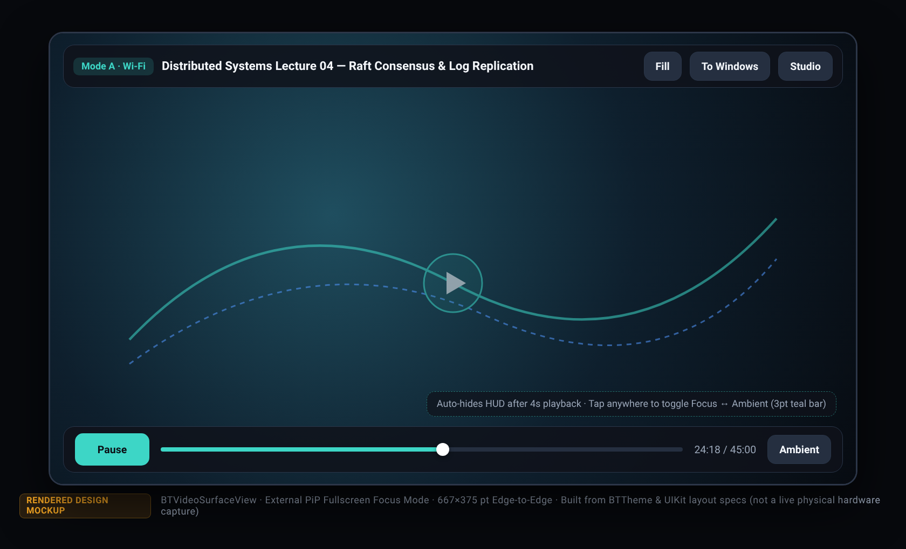

# External Picture-in-Picture (PiP) Engine

*Note: Image above is a rendered UI design mockup from `BTTheme` & `BTVideoSurfaceView` Auto Layout specifications, not a live physical iPhone capture.*

BackThread's core product experience treats the docked landscape iPhone 6 (`667×375 pt`, iOS 12.5.8, ~1 GB RAM) as a continuous **External PiP Display**: Windows handles development, browsing, or gaming while supported video renders directly on the iPhone with native `AVFoundation` hardware decoding.

## Native iOS Rendering Pipeline

Implemented across [`BTDirectMediaPlayer`](../src/iOS/Media/BTDirectMediaPlayer.m), [`BTVideoSurfaceView`](../src/iOS/UI/BTVideoSurfaceView.m), [`BTBufferedMediaEngine`](../src/iOS/Media/BTBufferedMediaEngine.m), and [`BTViewController`](../src/iOS/UI/BTViewController.m):

1. **Single Persistent `AVPlayerLayer`**:
   - `_directPlayer.playerLayer` is attached once into `_videoSurfaceView` (`insertSublayer:atIndex:0`).
   - Switching between **Studio Preview** (`BTVideoPresentationCompact` inside [`BTNowPlayingView`](../src/iOS/UI/BTNowPlayingView.m)), **Fullscreen Focus** (`BTVideoPresentationFocus`), and **Ambient Mode** (`BTVideoPresentationAmbient`) only toggles Auto Layout constraint sets (`_compactVideoConstraints` vs `_fullscreenVideoConstraints`).
   - `AVPlayer` and its decoder surface are NEVER torn down or reloaded during layout switches or notification overlays.

2. **Quality Caps & Screen-Wake Discipline**:
   - Supported quality caps (`auto`, `720p`, `480p`, `audio-only`) map onto `AVPlayerItem.preferredPeakBitRate`:
     - `720p`: capped at ~3.0 Mbps (`3,000,000` bps) to save thermal/A8 headroom
     - `480p`: capped at ~1.2 Mbps (`1,200,000` bps)
     - `audio-only`: capped at ~192 kbps
   - `UIApplication.sharedApplication.idleTimerDisabled` is set **only** when `keepScreenAwake == YES` AND an independent video session (`independentActive && hasVideoTrack && isPlaying`) is actively rendering in foreground; it automatically clears on pause, stop, background transition, or audio-only sessions.

3. **Three Presentation Modes on `BTVideoSurfaceView`**:
   - **Compact (`Studio Preview`)**: 16:9 inset slot beside track controls in `BTNowPlayingView`, with quick *Full PiP* pill.
   - **Focus (`PiP`)**: Edge-to-edge video canvas with translucent top HUD (`Mode Badge`, `Title`, `Fill/Fit`, `To Windows`, `Studio`) and bottom HUD (`Play/Pause`, seek bar, duration, `Ambient`) that auto-hides 4 seconds into active playback.
   - **Ambient (`Dark Desk Clock`)**: Tap *Ambient* (or stage in ambient) to dismiss HUD chrome completely, leaving only a bottom 3-pt teal progress bar and compact bottom-right `Mode · Time` chip—minimizing distraction beside a laptop in dark environments.

4. **Mode B Local File Streaming (`BTBufferedMediaEngine`)**:
   - Registers custom `backthread-buf://` URLs with [`BTBufferedMediaEngine`](../src/iOS/Media/BTBufferedMediaEngine.m) (`<AVAssetResourceLoaderDelegate>`).
   - Satisfies `AVAssetResourceLoadingContentInformationRequest` (MIME type, declared `totalBytes`, `byteRangeAccessSupported = YES`) and fulfills `AVAssetResourceLoadingDataRequest` incrementally as 256 KiB chunks arrive over USB Channel 6 (`media.buffered.start`, chunks, `media.buffered.eof`).
   - Strictly enforces a **24 MiB LRU RAM window** (`Caches/BackThreadBuffered` + in-memory chunk table) and immediately sheds evictable blocks on `UIApplicationDidReceiveMemoryWarningNotification`, keeping A8 footprint safe inside iOS 12's ~1 GB limit.

## Verification Boundaries

- **Verified (Linux + Cross-Build + Simulator/Unit Tests)**: Mode B chunk ingestion, range validation, generation fencing, Mode A handoff payloads, `MediaRouter` confirmation/failure state transitions, Clang static analysis (`22/22` clean), and ARM64 iOS 12 linking (`-Werror`).
- **Pending Hardware Acceptance**: Physical iPhone 6 screen pixels, A8 H.264 thermal stability, HLS Wi-Fi handoff while unplugging Lightning USB, and physical touch gestures remain untested in the Linux VM.
