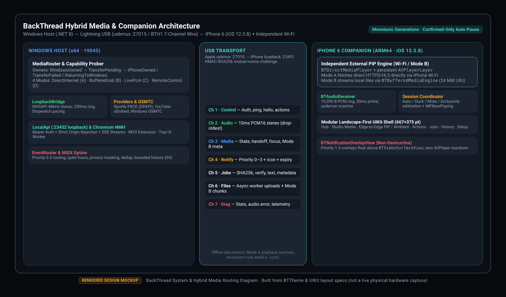

# Hybrid Media & Companion Routing Architecture

BackThread's hybrid media engine decouples **control, metadata, audio capture, and file transport (Lightning USB)** from **bulk direct Internet video streaming (iPhone Wi-Fi)** so the iPhone 6 can act as an independent External Picture-in-Picture (PiP) display while coding, gaming, or browsing on Windows.

## Ownership State Machine

Implemented in [`MediaRouter`](../src/Windows/Media/MediaRouter.cs) and [`MediaSessionState`](../src/Windows/Media/MediaModels.cs):

| Owner (`PlaybackOwner`) | Meaning | Windows Playback Behavior |
|---|---|---|
| `WindowsOwned` | Default state; media plays on Windows (GSMTC metadata + optional Mode C Live PCM). | Normal Windows playback |
| `TransferPending` | Windows requested handoff (`generation = N`) and is awaiting confirmation from `BTDirectMediaPlayer` or `BTYouTubeEmbedController`. | **Kept playing** until confirmed |
| `iPhoneOwned` | iPhone confirmed playback (`media.handoff.status {stage:"confirmed", generation:N}`). | Auto-paused **once** when `PauseWindowsOnConfirmedHandoff == true` |
| `TransferFailed` | Capabilities unsupported, stale generation, timeout/error reported by iPhone. | **Unchanged** (never paused on failed transfer) |
| `ReturningToWindows` | User or Host invoked `ReturnToWindows` (`media.return_to_windows`). | Optionally resumes Windows GSMTC session |

### Key Safety Invariants

1. **CONFIRMED-only Windows auto-pause**: Windows playback is NEVER paused on `TransferPending` or `TransferFailed`. Only a matching `generation` `confirmed` message triggers `PauseWindows` once (`hasAutoPausedWindowsForGeneration`).
2. **Monotonic generation fencing**: Every `SubmitMediaAsync` bumps `generation` monotonically. Stale confirmations or failure callbacks from prior generations are ignored cleanly on both Windows ([`MediaRouter.ApplyDeviceStatus`](../src/Windows/Media/MediaRouter.cs)) and iOS ([`BTDirectMediaPlayer`](../src/iOS/Media/BTDirectMediaPlayer.m)).
3. **USB disconnect survival & `media.sync` reconnect**:
   - Mode A (`DirectInternet`) video/audio continues buffering and playing directly over the iPhone's Wi-Fi if the Lightning cable is unplugged (`BTDirectMediaPlayer` + `BTViewController` connection status flips to `Wi-Fi Independent · USB Away`).
   - Upon USB reconnection, `HostRuntime` sends `media.sync` over Channel 3; `BTAgent` queries `BTViewController` (`syncSnapshot`), returning current `independentActive`, `generation`, `mode`, `positionSeconds`, `durationSeconds`, and `url` so Windows re-adopts the accurate `PlaybackOwner` state without interrupting playback.

## Four Playback Modes

- **Mode A (`DirectInternet`)**: Direct HTTPS/HLS URLs (`https://...mp4`, `.m3u8`, `.mp3`, `.aac`, `.m4a`). Windows probes compatibility with [`MediaCapabilityProber`](../src/Windows/Media/Handoff.cs) and sends only the handoff URL & preferences; iPhone streams straight via Wi-Fi into `AVPlayer`.
- **Mode B (`BufferedUsb`)**: Local Windows video/audio files streamed in 256 KiB chunks over USB Channel 6 (`BufferedMediaSource` -> `media.buffered.start` + binary frames -> `BTBufferedMediaEngine`). Served to `AVPlayer` via custom `backthread-buf://` `AVAssetResourceLoaderDelegate` backed by a 24 MiB bounded LRU cache.
- **Mode C (`LivePcm`)**: Universal fallback for DRM-protected apps, browser audio, games, and system sound (`LoopbackBridge` WASAPI 48 kHz stereo PCM16 -> USB Channel 2 -> `BTAudioReceiver` 19,200-byte ring -> `AudioQueue`).
- **Mode D (`RemoteControl`)**: Authoritative control over Windows GSMTC or official Spotify Web API Connect (`play`, `pause`, `toggle`, `next`, `previous`, `seek`).

## Audio Focus Arbitration

`AudioFocusPolicy` coordinates Windows Live PCM vs iPhone independent `AVPlayer` audio across [`HostRuntime`](../src/Windows/Host/HostRuntime.cs) and [`BTAudioSessionCoordinator`](../src/iOS/AudioReceiver/BTAudioSessionCoordinator.m):

- `Auto`: Normal priority arbitrage between active sources.
- `IndependentOnly`: Requests Host to mute/stop Live PCM focus while independent External PiP owns audio.
- `LivePcmOnly`: Mutes `AVPlayer` audio while preserving video playback (`KeepVideoMuteAudio` behavior with Windows audio primary).
- `KeepVideoMuteAudio`: Keeps PiP video running silently while listening to Windows Live PCM (e.g., gaming/calls on PC).
- `DuckVideo`: Attenuates `AVPlayer` volume (`0.35`) when Windows Live PCM audio is active.

## Local Control & Extension Surfaces

- Authenticated Loopback HTTP API (`http://127.0.0.1:23452/v1/*`) with SSE streams (`/v1/media/events`, `/v1/progress`) and strict browser `Origin` rejection ([`LocalApi`](../src/Windows/Host/LocalApi.cs)).
- WinForms System Tray UI ([`TrayContext`](../src/Windows/Tray/Program.cs)) with *Send Media to iPhone...*, *Return Playback to Windows*, *Audio Focus* submenu, *Spotify OAuth PKCE*, and *Notifications Permission*.
- Chromium MV3 Extension + Windows Native Messaging host ([`NativeMessagingHost`](../src/Windows/Host/NativeMessagingHost.cs), [`extensions/chromium`](../extensions/chromium/README.md)) using only `activeTab` + `nativeMessaging` permissions without weakening Host security boundaries.
