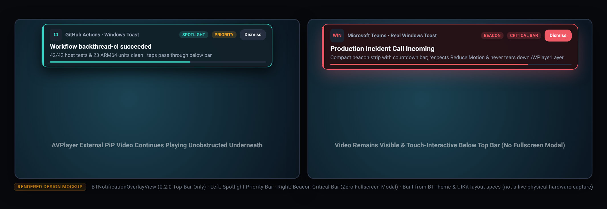

# Notification Routing & Overlay Acceptance Specification

*Note: Image above is a rendered UI design mockup from `BTTheme` & `BTNotificationOverlayView` Auto Layout specs, not a live physical iPhone capture.*

BackThread delivers rich Windows notifications to the iPhone while guaranteeing that alerts never corrupt or interrupt an active External Picture-in-Picture video stream.

## Priority Tiers & Filtering (`EventRouter`)

Implemented in [`EventRouter`](../src/Windows/Events/EventRouter.cs) and [`CompanionEvent`](../src/Windows/Events/EventRouter.cs):

| Priority | Presentation on iOS | Windows Routing Behavior | Auto-Dismiss Window |
|---|---|---|---|
| **0 (Low / Quiet)** | Stored in `BTHistoryPanelView` only (`_events`); no visual popup | Captured during normal or quiet hours | N/A |
| **1 (Notice)** | Compact top-center blue/teal notice bar (`NOTICE`, `480 pt` max width) | Rate-limited (max 10/s), deduplicated by key within window | `min(3.5s, remainingTTL)` |
| **2 (High / Spotlight Banner)** | Top-bar card (`540 pt` max) with optional `<=24 KiB` Base64 icon, title, body, countdown progress bar, and `"spotlight"` accent strip | Promoted automatically if `source` matches `HighNotificationSources` | `min(7.0s, remainingTTL)` |
| **3 (Critical / Beacon Bar)** | **Top-bar-only** highlighted crimson **Beacon** strip (`600 pt` max, `5 pt` left accent rail, `BEACON` + `CRITICAL BAR` badges, subtle Reduce-Motion-aware pulse, countdown bar, single-tap `"Dismiss"`). **No fullscreen modal backdrop** (`fullscreenActive` is permanently `NO`). | Promoted automatically if `source` matches `CriticalNotificationSources`; `NotificationCollector` maps real Windows toasts with `FullscreenEligible = false` and `Style = "beacon"` | `min(12.0s, remainingTTL)` or immediate manual Dismiss |

### Privacy, Suppression & Bounded Memory
- **Privacy Masking (`hideSensitive: true`)**: Replaces `title` with `"Private notification"`, clears `body`, clears `iconBase64`, clears `category`, and resets `style` to `"standard"` before sending over USB Channel 4 ([`EventRouter`](../src/Windows/Events/EventRouter.cs)).
- **Blocked Sources (`blockedSources`)**: Case-insensitive suppression applied before history retention.
- **Quiet Hours & Focus Suppression**: Quiet-hours/fullscreen Windows modes suppress Priority 1-2 interruptions (logged/retained at quiet Priority `0` or dropped safely) while honoring Priority 3 Beacon top bars unless explicitly disabled.
- **Bounded History**: Both `EventRouter` (Windows) and `BTViewController._events` (iOS) retain at most 64 unexpired notifications, pruning expired entries automatically.

## Non-Destructive Top-Bar Overlay Guarantee (`BTNotificationOverlayView`)

Verified in [`BTViewController.m`](../src/iOS/UI/BTViewController.m) and [`BTNotificationOverlayView.m`](../src/iOS/UI/BTNotificationOverlayView.m):
1. `BTNotificationOverlayView` sits above both `BTVideoSurfaceView` (PiP canvas) and `_embedHostView` (`[self.view bringSubviewToFront:_notificationOverlay]`).
2. Priority 1, 2, and 3 alerts NEVER present a fullscreen backdrop and NEVER pause, stop, swap out, or detach `AVPlayer` / `_directPlayer.playerLayer` on iOS (`fullscreenActive` always returns `NO`).
3. `-pointInside:withEvent:` restricts hit-testing strictly to `_card` for **all** priorities (`1–3`), so video touches and playback controls outside the top card work uninterrupted.
4. `BTNotificationOverlayView` renders a subtle attention pulse for `"beacon"` / `"spotlight"` styles only when `UIAccessibilityIsReduceMotionEnabled()` is `NO`.
5. `BTHistoryPanelView` lets the user inspect any stored notification or tap *"Preview Top Bar"* (`onReplayBannerTapped`) to replay it through the top-bar overlay.

## Windows Toast Ingestion & MSIX Packaging Ledger

- **Authenticated Loopback Event API (`POST /v1/events`), `style` routing, Privacy Masking & `NotificationCollector.BuildCompanionEvent` mapping**: **Verified** in [`HybridMediaTests`](../tests/BackThread.Tests/HybridMediaTests.cs) (`events.rich-priorities-and-privacy-masking`, `events.top-bar-beacon-style-and-toast-mapping`).
- **Official Windows Toast Listener (`NotificationCollector` + `packaging/msix/Build-Msix.ps1` + `GET /v1/notifications/diagnostics`)**: `UserNotificationListener` requires Windows package identity (`HasPackageIdentity == true`) plus interactive user consent (`POST /v1/notifications/request-access`). Unpackaged `Host.exe` / Linux runs report `"Unavailable"` with explicit actionable `guidance` rather than silently pretending toast capture works. Live Windows 10 MSIX signing (`Build-Msix.ps1`) and consent prompt testing remain pending on the physical Windows 10 host.
