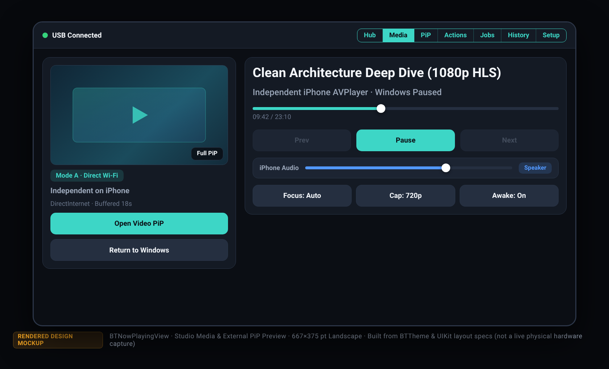
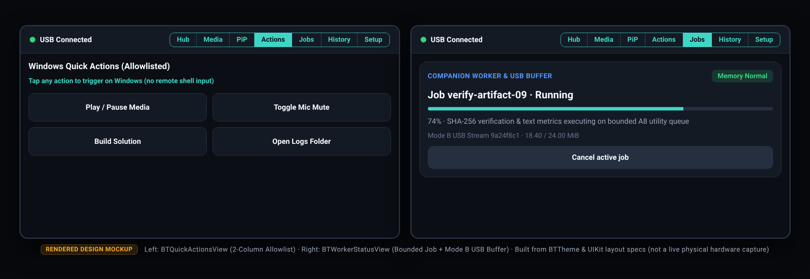

# BackThread Companion iOS UI Design (`667×375 pt` Landscape-First)

> **Disclosure:** All UI images below are **rendered design mockups** produced directly from the exact [`BTTheme`](../src/iOS/UI/BTTheme.m) palette and UIKit Auto Layout constraints via [`scripts/render-ui-previews.py`](../scripts/render-ui-previews.py). They are visual design documentation, **not** screenshots captured off a physical iPhone 6 screen.

## Design Philosophy & Ergonomics

BackThread is architected specifically for an **iPhone 6 (`667×375 pt` @ 2x = `1334×750 px`, Apple A8, iOS 12.5.8)** sitting docked beside a Windows laptop in **landscape orientation**, viewed from arm's length:
- **OLED/LCD Low-Glare Slate Theme (`BTTheme`)**:
  - Canvas `#0B0E14`, Card Surface `#141A24`, Elevated `#1C2432`, Pill `#252F40`, Hairline `#2A3649`.
  - Semantic accents: Teal `#3DD6C6` (Direct Wi-Fi / Primary CTAs), Blue `#5298FF` (Actions / Worker / Notice), Amber `#F5A623` (Mode B Buffered USB / Priority Banner), Green `#36D37C` (Live PCM / Healthy), Red `#F05A66` (Critical Alerts / Memory Warning).
- **Legibility & Touch Targets**: All interactive buttons enforce a minimum `44 pt` hit height (`48–52 pt` on overlay dismissals and quick action grids), monospaced digit timestamps (`monospacedDigitSystemFontOfSize`), and adaptive `UIStackView` axes switching cleanly between multi-column landscape and stacked portrait fallback (`viewDidLayoutSubviews` / `layoutSubviews`).

## Screen Inventory & Mockups

### 1. Studio Media & Hybrid Control (`BTNowPlayingView`)

Left `238 pt` column holds the live `16:9` `AVPlayerLayer` slot (`_videoSlotView`, shared zero-teardown with fullscreen PiP) or decoded artwork (<=128 px via `ImageIO`), mode chip (`Mode A–D`), ownership status, *Open Video PiP*, and *Return to Windows*. Right column exposes large 2-line track metadata, seek slider, Prev/Play-Pause/Next, native `MPVolumeView` output route/volume bar, and single-tap cycle chips for **Audio Focus** (`Auto`, `Duck`, `Mute`, `PCM`, `iPhone`), **Quality Cap** (`auto`, `720p`, `480p`, `audio-only`), and **Screen Wake Lock** (`Awake: On/Off`).

### 2. Fullscreen External PiP Focus & Ambient (`BTVideoSurfaceView`)

Edge-to-edge hardware `AVPlayerLayer` with translucent top/bottom HUD panels auto-hiding after 4s of playback. Tap **Fill / Fit** to switch `AVLayerVideoGravityResizeAspectFill` vs `ResizeAspect`, **Ambient** for dark distraction-free desk viewing (3-pt teal bottom progress bar + compact corner timestamp badge), **Studio** to collapse back to `BTNowPlayingView`, or **To Windows** to hand playback back cleanly.

### 3. Landscape Idle Companion Hub (`BTIdleHubView`)

Three equal columns on wake: **Companion & Audio** (USB/Wi-Fi state + 48 kHz PCM ring occupancy/drops + active mode summary), **Quick Actions** (top 3 allowlisted shortcuts synced from Windows), and **Worker & Notifications** (live bounded job progress + latest notification preview).

### 4. Non-Destructive Notifications (`BTNotificationOverlayView` & `BTHistoryPanelView`)

Priority 1-3 alerts overlay above the video stage without disturbing `AVPlayer`. Notification History lets users inspect and fullscreen-replay any unexpired notification stored in the 64-entry bounded queue.

### 5. Allowlisted Quick Actions, Bounded Worker & Diagnostics (`BTQuickActionsView`, `BTWorkerStatusView`, `BTSettingsView`)

- **`BTQuickActionsView`**: 2-column landscape touch buttons populated only from Windows-signed `action.registry` IDs (no arbitrary remote shell execution).
- **`BTWorkerStatusView`**: Displays current file hashing/verification/text/metadata job progress, A8 memory-pressure status badge, cooperative Cancel button, and Mode B USB buffer transfer progress (`receivedBytes / totalBytes`).
- **`BTSettingsView`**: Provides secure 64-hex key pairing (`NSFileProtectionCompleteUntilFirstUserAuthentication`), live PCM ring & `BTAudioSessionCoordinator` diagnostics, manual buffered cache eviction, and history wipe.
