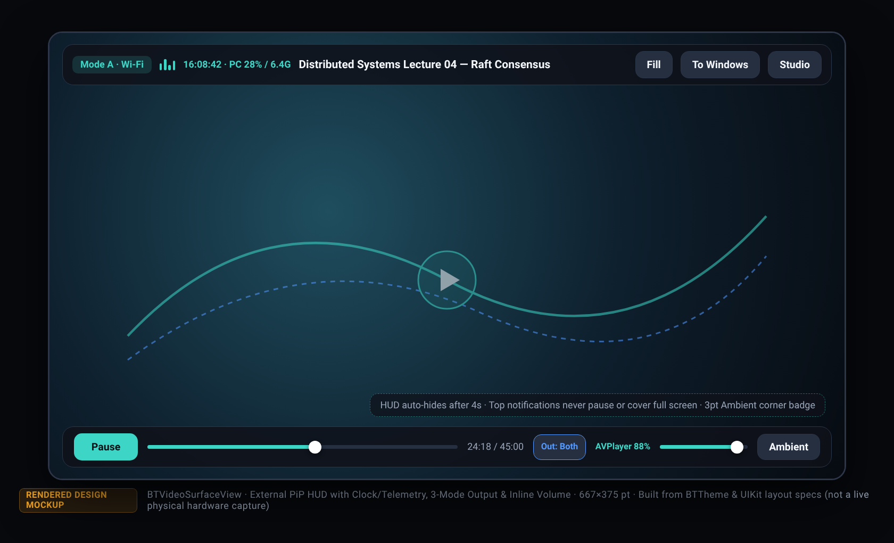
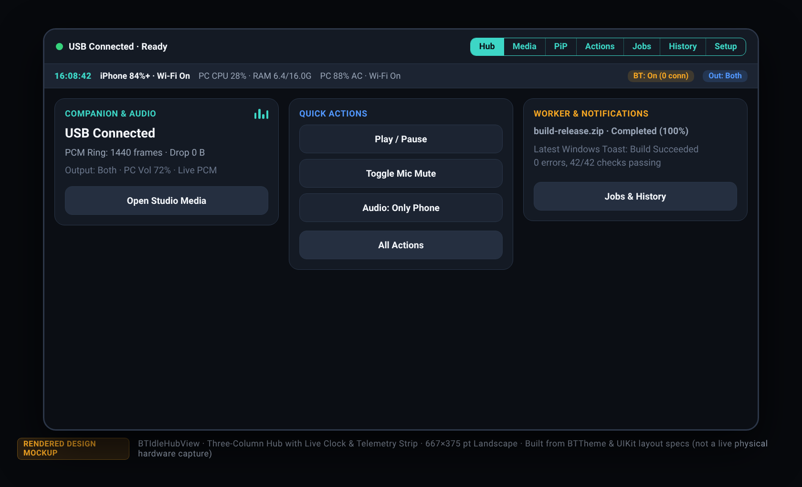
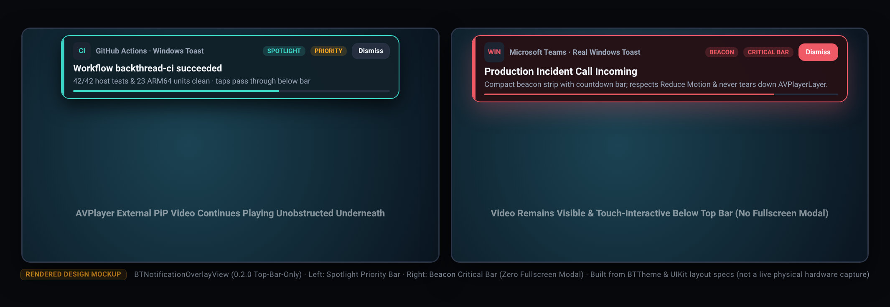

# BackThread Companion iOS UI Design (`667×375 pt` Landscape-First)

> **Disclosure:** All UI images below are **rendered design mockups** produced directly from the exact [`BTTheme`](../src/iOS/UI/BTTheme.m) palette and UIKit Auto Layout constraints via [`scripts/render-ui-previews.py`](../scripts/render-ui-previews.py). They are visual design documentation, **not** screenshots captured off a physical iPhone 6 screen.

## Design Philosophy & Ergonomics

BackThread is architected specifically for an **iPhone 6 (`667×375 pt` @ 2x = `1334×750 px`, Apple A8, iOS 12.5.8)** sitting docked beside a Windows laptop in **landscape orientation**, viewed from arm's length:
- **OLED/LCD Low-Glare Slate Theme (`BTTheme`)**:
  - Canvas `#0B0E14`, Card Surface `#141A24`, Elevated `#1C2432`, Pill `#252F40`, Hairline `#2A3649`.
  - Semantic accents: Teal `#3DD6C6` (Direct Wi-Fi / Primary CTAs), Blue `#5298FF` (Actions / Worker / Notice), Amber `#F5A623` (Mode B Buffered USB / Priority Banner), Green `#36D37C` (Live PCM / Healthy), Red `#F05A66` (Critical Alerts / Memory Warning).
- **Legibility & Touch Targets**: All interactive buttons enforce a minimum `44 pt` hit height (`48–52 pt` on overlay dismissals and quick action grids), monospaced digit timestamps (`monospacedDigitSystemFontOfSize`), and adaptive `UIStackView` axes switching cleanly between multi-column landscape and stacked portrait fallback (`viewDidLayoutSubviews` / `layoutSubviews`).

- **Live Clock & Telemetry Strip (`BTTelemetryStripView`)**: A persistent `26 pt` slate header bar displaying a 1-second monospace local clock (`HH:mm:ss`), iPhone battery percentage & Wi-Fi state (strictly via public `UIDevice` and `SystemConfiguration`/`getifaddrs` APIs), Windows host CPU%, RAM used/total, PC battery/AC state, Wi-Fi status, an honest Bluetooth pill (`BT: N conn` vs `BT: On (0)` vs `BT: Off` computed strictly from `Aep.IsConnected`), and the active audio output badge (`Out: Both` / `Out: PC` / `Out: Phone`).

## Screen Inventory & Mockups

### 1. Studio Media & Hybrid Control (`BTNowPlayingView`)

Left `224 pt` column holds the live `16:9` `AVPlayerLayer` slot (`_videoSlotView`, shared zero-teardown with fullscreen PiP) or decoded artwork (<=128 px via `ImageIO`), mode chip (`Mode A–D`), animated playback equalizer bars (`BTEqualizerView`, disabled automatically when `UIAccessibilityIsReduceMotionEnabled()` is active), ownership status, *Open Video PiP*, and *Return to Windows*. Right column exposes track metadata, seek slider, Prev/Play-Pause/Next, the **3-mode Audio Output selector** (`Only PC` | `Only Phone` | `Both`), the **inline labeled Volume Slider** cycling `PC Vol` / `App Gain` / `AVPlayer` beside `MPVolumeView` route button (plus a clear warning banner if the audio driver couples PC speaker mute to zero loopback capture), and single-tap cycle chips for **Audio Focus**, **Quality Cap**, and **Screen Wake Lock**.

### 2. Fullscreen External PiP Focus & Ambient (`BTVideoSurfaceView`)

Edge-to-edge hardware `AVPlayerLayer` with translucent top/bottom HUD panels auto-hiding after 4s of playback. Top HUD includes `BTEqualizerView`, live clock (`HH:mm:ss`) + PC CPU/RAM chip, and **Fill / Fit**, **To Windows**, **Studio** actions. Bottom HUD embeds a compact **3-mode output cycle button** and **inline labeled volume slider** (`PC` / `App` / `AVP` percentage) directly alongside **Ambient** mode (which also keeps a compact clock + telemetry corner badge).

### 3. Landscape Idle Companion Hub (`BTIdleHubView`)

Three equal columns beneath the `BTTelemetryStripView` bar: **Companion & Audio** (USB/Wi-Fi state + 48 kHz PCM ring occupancy/drops + live equalizer indicator), **Quick Actions** (top 3 allowlisted shortcuts synced from Windows), and **Worker & Notifications** (live bounded job progress + latest notification preview).

### 4. Non-Destructive Top-Bar Notifications (`BTNotificationOverlayView` & `BTHistoryPanelView`)

**Top-Bar-Only Presentation (`0.2.0`)**: Priority 1–3 notifications render exclusively as compact floating top cards (`fullscreenActive` is permanently `NO`; video stays visible and touch-interactive beneath the card via `-pointInside:withEvent:` pass-through). Special notification styles (`"spotlight"` and `"beacon"`) add a `4–5 pt` glowing accent rail, countdown progress bar, and Reduce-Motion-aware pulse animation without ever tearing down `AVPlayerLayer`. Notification History lets users inspect or trigger a *"Preview Top Bar"* replay of any active entry in the 64-entry queue.

### 5. Allowlisted Quick Actions, Bounded Worker & Diagnostics (`BTQuickActionsView`, `BTWorkerStatusView`, `BTSettingsView`)

- **`BTQuickActionsView`**: 2-column landscape touch buttons populated only from Windows-signed `action.registry` IDs (no arbitrary remote shell execution).
- **`BTWorkerStatusView`**: Displays current file hashing/verification/text/metadata job progress, A8 memory-pressure status badge, cooperative Cancel button, and Mode B USB buffer transfer progress (`receivedBytes / totalBytes`).
- **`BTSettingsView`**: Provides secure 64-hex key pairing (`NSFileProtectionCompleteUntilFirstUserAuthentication`), live PCM ring & `BTAudioSessionCoordinator` diagnostics, manual buffered cache eviction, and history wipe.
